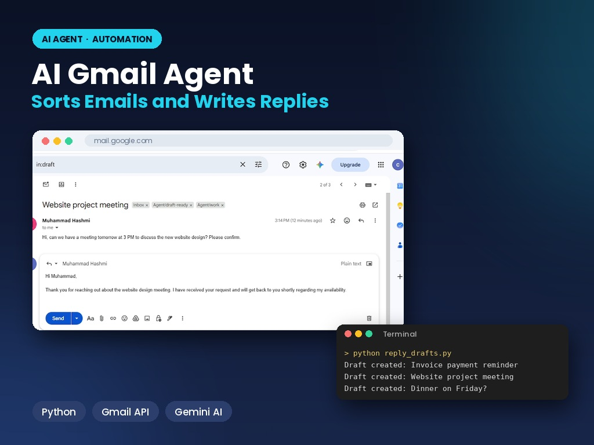

# AI Gmail Agent

A Python agent that reads new Gmail messages, sorts them into categories with Google Gemini, adds Gmail labels, and writes reply drafts for the emails that need an answer.

**It never sends an email by itself.** It only creates drafts, so a human always checks them before anything goes out.



## What it does

1. **Classifies new emails.** It takes inbox emails that don't have an `Agent/...` label yet and sends them to Gemini in one batch. Each email gets one of six categories: `important`, `work`, `personal`, `promotions`, `newsletters`, `spam`, plus a one-line summary. The agent then adds a Gmail label such as `Agent/work`.
2. **Writes reply drafts.** For emails labelled important, work or personal, it skips no-reply senders and asks Gemini for a short, polite reply. The reply is saved as a draft in the same email thread, and the email gets an `Agent/draft-ready` label.
3. **Runs on a schedule.** `run_forever.py` runs both steps every 2 hours and writes everything to `log.txt`.

## How it is built

```
read_emails.py      Google OAuth login, saved token, and parse_json_list() to read the AI's JSON
classify_emails.py  step 1: fetch unlabelled emails -> one Gemini call -> validate -> add labels
reply_drafts.py     step 2: pick emails that need a reply -> Gemini writes replies -> create drafts
run_forever.py      runs step 1 and step 2 every 2 hours, logs to log.txt
run_agent.bat       runs both steps once (for Windows Task Scheduler)
```

Design choices:

- **Human in the loop.** The code only creates drafts. Nothing is sent automatically.
- **One batch per run.** All emails go to Gemini in a single request, to save API calls on the free tier.
- **Less data shared.** Only the sender, subject and a short snippet are sent to the AI, not the full email.

## Safety and reliability

- **Output validation.** If the AI returns an id that doesn't exist, that email is skipped and logged. If it invents a category outside the list, the email goes to `personal` instead of creating a random label.
- **Prompt-injection guard.** The prompt tells the model never to follow instructions written inside emails.
- **No duplicates.** Emails that already have a draft (or the `Agent/draft-ready` label) are skipped.
- **Robust JSON parsing.** `parse_json_list()` handles answers wrapped in code fences or extra text.
- **One failure doesn't stop the run.** Each email is handled in its own `try/except`.
- **Expired login.** Google tokens for apps in testing mode expire after 7 days. The agent catches this and asks you to log in again.
- **Unicode-safe logs.** UTF-8 mode is forced so emoji or non-English subjects don't crash the log on Windows.

## Setup

1. Install Python 3.10+ and create a virtual environment:
   ```
   python -m venv venv
   venv\Scripts\activate        (Windows)
   pip install -r requirements.txt
   ```
2. In [Google Cloud Console](https://console.cloud.google.com/), create a project, enable the **Gmail API**, create an **OAuth client ID** (Desktop app), and download it as `credentials.json` into this folder.
3. Get a free API key from [Google AI Studio](https://aistudio.google.com/), copy `.env.example` to `.env`, and put your key in it.
4. Run it:
   ```
   python classify_emails.py     # label new emails
   python reply_drafts.py        # create reply drafts
   python run_forever.py         # or run both every 2 hours
   ```
   The first run opens a browser so you can log in to Gmail. A `token.json` file is then saved locally.

> `credentials.json`, `token.json` and `.env` contain private keys. They are listed in `.gitignore` and must never be uploaded.

## What I'd like to improve

- Measure accuracy properly, for example by labelling 50 emails by hand and comparing them with the agent.
- Read the full email body (safely) instead of only the snippet.
- Run it as a proper background service instead of a loop.

## Tech

Python · Gmail API · Google OAuth 2.0 · Google Gemini API (`google-genai`) · python-dotenv

## Author

**Muhammad Hashmi** · Swat, Pakistan · hashmi.freelance@gmail.com
